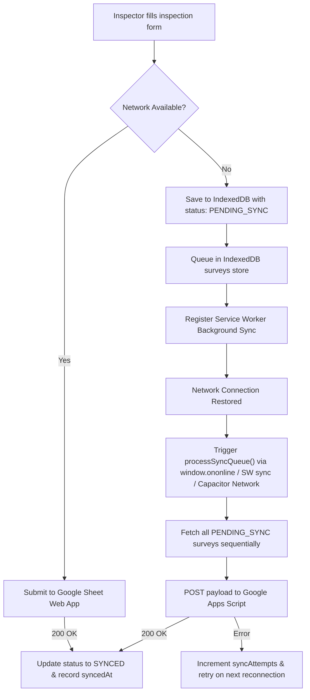

# VKU Field Survey — Offline Data Collection (PWA & Capacitor)

> **Course:** Cross-Platform Mobile App Development (VKU) — Mini-Project 1  
> **Student Name:** Nguyễn Thái Sơn  
> **Student ID:** 23IT.EB086  
> **GitHub Repository:** [https://github.com/nguyenthaison2408/vku-survey](https://github.com/nguyenthaison2408/vku-survey)  
> **🔗 Live Demo PWA URL:** [https://vku-survey.pages.dev](https://vku-survey.pages.dev)  
> **Submission Milestones:**  
> - **Phase 1 (Week 3):** Offline-First Progressive Web App (PWA) with Service Worker, IndexedDB & Cloudflare Pages  
> - **Phase 2 (Week 4):** Cross-Platform Native Android App (Capacitor Bridge, Hardware Camera & Network Plugins, APK Build)

---

## 📌 Executive Summary & Problem Scenario

Campus facility inspectors and student auditors at **Vietnam - Korea University of Information and Communication Technology (VKU)** regularly audit equipment, projectors, air conditioners, and electrical facilities in basements, lecture halls, and remote buildings where Wi-Fi and cellular 4G/5G connections are weak or absent.

**VKU Field Survey** is built to solve this challenge with a true **Offline-First** architecture:
1. Operates 100% offline without initial network dependence.
2. Persists data locally in real time using **IndexedDB** (`idb`).
3. Automatically queues payloads and dispatches them via **Background Sync** when connectivity resumes.
4. Directly stores survey records and audit photos to **Google Sheets** & **Google Drive** via Google Apps Script Web App.
5. Deployed both as a **PWA Standalone App** and as a **Native Android APK** via Capacitor.

---

## 📦 Submission Deliverables

| Deliverable | Description | Link / Access |
|:---|:---|:---|
| **1. Live Demo URL** | Cloudflare Pages production deployment (PWA Standalone) | 🔗 [https://vku-survey.pages.dev](https://vku-survey.pages.dev) |
| **2. GitHub Repository** | Complete source code, modular structure, Capacitor native project | 💻 [https://github.com/nguyenthaison2408/vku-survey](https://github.com/nguyenthaison2408/vku-survey) |
| **3. Technical Report** | Comprehensive technical report adhering to VKU standard template | 📄 `VKU_Survey_Technical_Report.pdf` / `.docx` |

---

## 🚀 Two-Phase Implementation Breakdown

```
VKU Field Survey Architecture
├── 🌐 PHASE 1: Web PWA (Offline-First Core)
│   ├── Responsive Mobile Shell (Tailwind CSS, VKU Blue #0284c7)
│   ├── Service Worker (Cache-First App Shell + Offline Page)
│   ├── IndexedDB Storage (idb: surveys, drafts, settings)
│   ├── Offline Queue & Background Sync Engine
│   ├── Google Sheets & Drive Webhook Dispatcher
│   └── Production Deployment: Cloudflare Pages
│
└── 📱 PHASE 2: Capacitor Native Android Layer
    ├── Native Bridge (@capacitor/core & @capacitor/android)
    ├── Native Hardware Camera (@capacitor/camera) + Permission Request
    ├── Real-time Network Monitoring (@capacitor/network)
    └── Gradle & Android Studio APK Compilation
```

---

# 🌐 PHASE 1: Progressive Web App (PWA)

Phase 1 focuses on building a resilient, offline-capable Single Page Application installable on any modern mobile and desktop browser.

### 🌟 Phase 1 Key Features
- **PWA Standalone Installation:** Configured with `manifest.webmanifest`, `display: standalone`, primary theme color `#0284c7`, and crisp responsive icons (192x192, 512x512).
- **Service Worker Cache-First Strategy:** Built with `vite-plugin-pwa` (`injectManifest` mode). Pre-caches the App Shell (HTML, JS, CSS, fonts) for instant sub-second cold starts even in airplane mode.
- **5-Step Inspection Workflow:**
  1. *Location:* Building selection (Nhà A, B, C, D, Thư viện, KTX, v.v.), Floor, Room.
  2. *Equipment Category:* Hardware, Projector, AC, Electrical, Furniture.
  3. *Condition Rating:* 5-star rating synced with quick condition chips (Kém, Trung bình, Khá, Tốt, Rất tốt).
  4. *Field Notes:* Detailed textual description of defects.
  5. *Photo Evidence:* Camera capture or image picker with real-time Base64 preview and size display.
- **IndexedDB Draft Persistence:** Multi-step form auto-saves into the `drafts` store upon every keystroke. Reloading the page or closing the browser resumes the inspection without losing progress.
- **Offline Queue Engine:** Submitting without internet saves the survey with status `PENDING_SYNC`. Upon network recovery, it is automatically processed and transitioned to `SYNCED`.
- **Google Sheets Integration:** Supports sending survey rows directly to a Google Sheet and uploading captured inspection photos to a Google Drive folder (`VKU_Survey_Photos`) through Google Apps Script.

### 💻 Running Phase 1 (Web PWA)

#### 1. Install Dependencies
```bash
npm install
```

#### 2. Run Local Development Server
```bash
npm run dev
```
Open browser at `http://localhost:5173/`.

#### 3. Build Production PWA
```bash
npm run build
```
Generates production assets in `dist/` with precached service worker (`dist/sw.js`).

#### 4. Preview Production Build
```bash
npm run preview
```

#### 5. Deploy to Cloudflare Pages
```bash
npm run deploy
```
*Note:* Deploys `dist/` to Cloudflare Pages project `vku-survey` on the `main` branch.

### 📊 Google Sheets Backend Setup (Optional / Integrated)
A ready-to-use Google Apps Script file is located at [`google_apps_script.js`](./google_apps_script.js).
1. Create a Google Sheet, open **Extensions > Apps Script**, and paste the code from `google_apps_script.js`.
2. Click **Deploy > New deployment**, select **Web app**, set *Who has access* to **Anyone**.
3. Copy the Web App URL.
4. On the web app, click the **Settings (⚙️)** button in the top navigation bar, paste your Web App URL, and click **Lưu cấu hình**.

---

# 📱 PHASE 2: Capacitor Native Android

Phase 2 wraps the offline-first web application into a native Android APK using the Capacitor runtime bridge, accessing device-level hardware APIs and native background events.

### 🌟 Phase 2 Key Features
- **Capacitor Native Bridge (`@capacitor/core`, `@capacitor/android`):** Bridges modern web APIs with native Android Java runtime.
- **Native Hardware Camera (`@capacitor/camera`):**
  - Triggers native Android Camera intent (`CameraSource.Camera`) or gallery picker (`CameraSource.Photos`).
  - Auto-compresses captured photos to high-quality JPEG (quality 85) to optimize storage in IndexedDB and transmission payload.
  - Native runtime permission requests declared in `AndroidManifest.xml`:
    - `android.permission.CAMERA`
    - `android.permission.READ_EXTERNAL_STORAGE`
    - `android.permission.WRITE_EXTERNAL_STORAGE`
    - `android.permission.READ_MEDIA_IMAGES`
- **Native Network Monitor (`@capacitor/network`):**
  - Listens to device connectivity state changes at the OS level.
  - Triggers the offline sync queue immediately when Android switches from disconnected to Wi-Fi / Mobile data.
- **Cross-Platform Fallback:** Seamless fallback to standard HTML5 `<input type="file" accept="image/*" capture="environment">` when running on a regular web browser.

### 💻 Building & Running Phase 2 (Android APK)

#### Prerequisites
- **Java Development Kit (JDK):** Version 17 (e.g. `C:\Program Files\Java\jdk-17`)
- **Android SDK:** Installed via Android Studio (default `C:\Users\<User>\AppData\Local\Android\Sdk`)
- **Android Studio** (for emulator testing and release signing)

#### 1. Build Web Assets & Sync to Android
```bash
npm run cap:build
```
*This command executes `npm run build` and then copies all output into `android/app/src/main/assets/public/`.*

#### 2. Open Project in Android Studio
```bash
npm run cap:open
```
Inside Android Studio:
1. Wait for Gradle sync to finish.
2. Select an Android Emulator or connected physical device.
3. Click the green **Run (▶)** button.
4. To generate an APK file: Go to **Build > Build Bundle(s) / APK(s) > Build APK(s)**.

#### 3. Build Debug APK via Command Line (CLI)
You can directly compile the debug APK using the Gradle wrapper:
```bash
# Set JAVA_HOME if not already configured in your environment
$env:JAVA_HOME = "C:\Program Files\Java\jdk-17"

# Build debug APK
npm run build:apk
```
The compiled APK will be generated at:
```
android/app/build/outputs/apk/debug/app-debug.apk
```

#### 4. Install APK onto Connected Android Device
```bash
adb install android/app/build/outputs/apk/debug/app-debug.apk
```

---

## 🏗️ Project Architecture & Directory Structure

```
vku-survey/
├── android/                               # Phase 2: Native Android project (Capacitor)
│   ├── app/
│   │   ├── src/main/
│   │   │   ├── AndroidManifest.xml        # Android hardware permissions (Camera, Network)
│   │   │   ├── java/                      # Native MainActivity
│   │   │   └── res/                       # App icons & Android launch resources
│   │   └── build.gradle                   # App Gradle configuration
│   ├── build.gradle                       # Root Gradle configuration
│   └── capacitor.settings.gradle          # Capacitor auto-injected plugin links
│
├── public/                                # Static PWA assets
│   ├── favicon.svg
│   ├── icon-192.svg / icon-512.svg        # Standard PWA installation icons
│   └── manifest.webmanifest               # PWA standalone manifest configuration
│
├── src/                                   # Phase 1: Core application source code
│   ├── components/
│   │   ├── star-rating.ts                 # 5-star rating component with DOM safety
│   │   └── toast.ts                       # Transient user feedback toasts
│   ├── pages/
│   │   ├── home.ts                        # Dashboard: sync stats, recent audits, settings modal
│   │   ├── survey.ts                      # 5-step inspection form with real-time draft persistence
│   │   └── history.ts                     # Survey list with filter tabs (All, Pending, Synced)
│   ├── camera.ts                          # Cross-platform camera module (Capacitor + HTML5 fallback)
│   ├── db.ts                              # IndexedDB wrapper (surveys, drafts, settings stores)
│   ├── network.ts                         # Network status listener (Capacitor Network + window.ononline)
│   ├── router.ts                          # Lightweight hash-based SPA router
│   ├── sync.ts                            # Offline queue processor & Google Sheets dispatcher
│   ├── sw.ts                              # Service Worker: Cache-First + skipWaiting + sync event
│   ├── main.ts                            # Application bootstrap, SW registration, global events
│   └── style.css                          # Tailwind CSS custom styles & VKU palette
│
├── capacitor.config.ts                    # Capacitor bridge configuration
├── google_apps_script.js                  # Google Sheets backend receiver script
├── index.html                             # Main HTML entry with mobile viewport meta
├── package.json                           # NPM dependencies and workflow scripts
├── tailwind.config.js                     # Tailwind styling configuration
├── tsconfig.json                          # TypeScript configuration
└── vite.config.ts                         # Vite bundler & Vite-Plugin-PWA configuration
```

---

## 📊 Data Schema & Storage Architecture

### IndexedDB Database: `vku-survey-db` (Version 1)

```typescript
// Store 1: 'surveys' (KeyPath: 'id')
interface Survey {
  id: string                   // UUID v4
  status: 'DRAFT' | 'PENDING_SYNC' | 'SYNCED'
  building: string             // e.g. "Nhà A", "Nhà B", "Thư viện"
  floor: string                // e.g. "Tầng 1", "Tầng 2"
  room: string                 // e.g. "Phòng 101"
  category: 'Hardware' | 'Projector' | 'AC' | 'Electrical' | 'Furniture'
  rating: 1 | 2 | 3 | 4 | 5    // Facility condition assessment
  notes: string                // Inspector commentary
  photoBase64: string | null   // Base64 JPEG photo
  createdAt: string            // ISO 8601 timestamp
  syncedAt: string | null      // ISO 8601 timestamp when pushed to server
  syncAttempts: number         // Retry counter
}

// Store 2: 'drafts' (Key: 'active-survey-draft')
// Holds in-progress multi-step form data to guarantee 0% data loss

// Store 3: 'settings' (Key: 'api-endpoint')
// Stores user-defined Google Apps Script Web App URL
```

---

## 🔄 Offline Synchronization Flow



---

## ✅ Evaluation & Acceptance Checklist

### Phase 1: Web PWA Verification
- [x] **PWA Standalone:** Valid `manifest.webmanifest`, `display: standalone`, `#0284c7`, installable on Chrome/Edge/Safari.
- [x] **Offline Boot:** Service Worker caches App Shell (`sw.ts`). Loads in < 1 second in offline mode.
- [x] **Multi-Step Form:** 5-step wizard with building, room, category, interactive 5-star rating, and image attachment.
- [x] **Real-Time Draft Auto-Save:** Form state persists across browser refreshes and tab reopens.
- [x] **Offline Queue:** Submissions without internet transition to `PENDING_SYNC`.
- [x] **Automatic Background Sync:** Flushes queue upon network restoration without manual reload.
- [x] **Google Sheets Sync:** Directly writes rows and uploads photos to Google Drive.
- [x] **Production Deployment:** Live on Cloudflare Pages (`https://vku-survey.pages.dev`).

### Phase 2: Capacitor Native Android Verification
- [x] **Capacitor Integration:** Complete `@capacitor/core` and `@capacitor/android` configuration.
- [x] **Native Camera:** Uses `@capacitor/camera` with proper permissions (`CAMERA`, `READ_EXTERNAL_STORAGE`).
- [x] **Native Network Monitor:** Uses `@capacitor/network` to react to Android connectivity states.
- [x] **Clean Scaffolding:** Native Android Studio project generated and synced (`android/`).
- [x] **Gradle Build Pipeline:** Clean build via `gradlew assembleDebug` and Android Studio.

---

## 👨‍💻 Student Author
- **Nguyễn Thái Sơn** — Student ID: **23IT.EB086**
- Faculty of Information Technology, Vietnam - Korea University of Information and Communication Technology (VKU)
